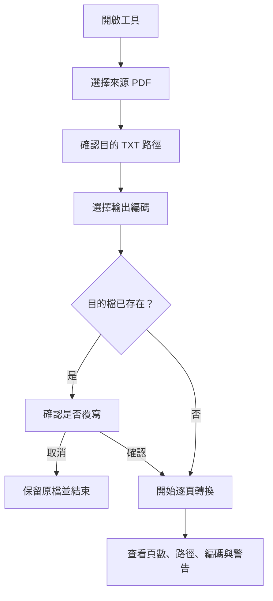

# 中文 PDF 轉 TXT 使用者操作手冊

本工具將單一電子 PDF 的既有文字擷取成 TXT，支援繁體中文與多種輸出編碼。所有處理都在本機完成，不會上傳文件；本工具不含 OCR。

## 目錄

- [快速開始](#快速開始)
- [整體使用流程](#整體使用流程)
- [操作介面](#操作介面)
- [選擇輸出編碼](#選擇輸出編碼)
- [轉換結果與檔案安全](#轉換結果與檔案安全)
- [隱私與限制](#隱私與限制)
- [常見問題](#常見問題)
- [圖示與桌面捷徑](#圖示與桌面捷徑)
- [建立免安裝版](#建立免安裝版)
- [維護者驗證](#維護者驗證)

## 快速開始

### 免安裝版使用者

取得 `dist\PdfToTxt.exe` 後，在 Windows 10／11 上雙擊即可開啟，不需要另外安裝 Python。首次啟動單檔程式時，Windows 可能需要數秒解開執行所需檔案。

命令列免安裝版為 `dist\PdfToTxtCli.exe`，在 PowerShell 或命令提示字元中指定 PDF 與 TXT 路徑：

```powershell
.\dist\PdfToTxtCli.exe "C:\文件\來源.pdf" "C:\文件\輸出.txt"
```

若輸出檔已存在，程式會詢問是否覆寫；輸入 `y` 或 `yes` 確認，其他回答會取消並保留原檔。轉換成功時回傳結束碼 `0`；參數格式錯誤回傳 `2`，取消或轉換失敗回傳非零結束碼。命令列版使用自動編碼（優先 CP950，必要時 UTF-8）。

### 從原始碼啟動

需要 Python 3.11 以上，安裝時須包含 tkinter。在專案資料夾雙擊 `start_pdf_to_txt.bat`；批次檔會尋找 Python 3.11 以上版本，並以英文顯示啟動錯誤。

若尚未安裝 PyMuPDF，請在 PowerShell 進入專案資料夾並執行：

```powershell
python -m pip install -r requirements.txt
python pdf_to_txt.py
python pdf_to_txt.py "C:\文件\來源.pdf" "C:\文件\輸出.txt"
```

## 整體使用流程



## 操作介面

| 介面項目 | 使用方式 |
| --- | --- |
| 來源 PDF | 輸入完整路徑，或按「瀏覽…」選取 `.pdf` 檔案。支援中文、空白及合法 Windows 路徑字元。 |
| 目的 TXT | 輸入完整路徑，或按「另存為…」指定 `.txt` 檔案。目的資料夾必須已存在。 |
| 輸出編碼 | 預設為「自動（優先 CP950，必要時 UTF-8）」。也可手動指定其他編碼。 |
| 開始轉換 | 檢查路徑並開始轉換。若目的檔存在，會先詢問是否覆寫。 |
| 進度與狀態 | 顯示目前頁數、完成結果或錯誤。轉換期間其他控制項會停用。 |

按「瀏覽…」選擇來源時，如果目的欄位為空，工具會預填相同資料夾、相同檔名的 `.txt` 路徑；已有目的路徑時會保留原設定。手動輸入非 `.txt` 副檔名時，工具會提示修正。

## 選擇輸出編碼

| 選項 | 輸出方式與適用情況 |
| --- | --- |
| 自動（優先 CP950，必要時 UTF-8） | 預設。全文可用 CP950 表示時輸出 CP950；否則整份輸出無 BOM 的 UTF-8。 |
| ANSI（繁中 Windows／CP950） | 固定使用 CP950，適合要求傳統繁中 Windows 編碼的軟體。 |
| UTF-8 | 無 BOM，適合跨平台使用。 |
| UTF-8 BOM | 含 BOM，適合需要 BOM 辨識 UTF-8 的軟體。 |
| Big5 | 傳統 Big5 編碼；可表示的字元範圍與 CP950 不完全相同。 |
| UTF-16 LE BOM | 小端序 UTF-16，明確寫入 `FF FE` BOM。 |

PDF 通常沒有可供工具判定的單一 CP950、Big5 或 UTF-8 編碼。工具先從 PDF 文字層取得 Unicode 文字；自動模式選擇的是 TXT 輸出編碼，不是偵測 PDF 原始編碼。完成訊息會顯示最後採用的編碼。

所有手動編碼都採嚴格轉換。若有字元無法以所選編碼表示，工具會停止並顯示第一個字元、Unicode 碼位和所在頁碼，不會用問號取代；原目的檔會保留。可改選自動、UTF-8 或 UTF-8 BOM 再試一次。

## 轉換結果與檔案安全

轉換完成時會顯示總頁數、輸出路徑、實際輸出編碼，以及未擷取到文字的頁碼。頁面依原頁序輸出，頁與頁之間加入一個空白行，換行統一為 Windows CRLF。

若目的檔已存在，必須明確確認覆寫。工具先在目的資料夾建立暫存檔；所有頁面擷取、編碼和寫入成功後，才替換目的檔。發生錯誤時會清理本次暫存檔並保留原檔。若目的檔在確認後又被其他程式修改，工具會中止並要求重新確認。

轉換中請等待完成再關閉視窗。工具不會中途終止寫檔。

## 隱私與限制

- PDF 與 TXT 都在本機處理，工具不會上傳文件。
- 只擷取 PDF 既有文字層，不含 OCR。整份 PDF 沒有文字時會停止，並提示可能需要 OCR；個別頁面無文字時會列出頁碼提醒，但這不代表已確認該頁是掃描頁。
- 多欄、表格、直排文字及特殊字型的閱讀順序可能不正確；表格只會當作一般文字擷取，不還原表格結構。
- 可選取或複製文字，不保證 PDF 字型的字元對應正確。若 PDF 本身缺少正確映射，輸出可能仍有亂碼；改變 TXT 編碼無法修復來源文字映射。
- 工具不處理批次轉換、密碼輸入、圖片匯出或原版面重建。受密碼保護的 PDF 請先取得已解密副本。

## 常見問題

### 找不到來源 PDF

確認路徑及檔名正確，檔案存在且副檔名為 `.pdf`。可使用「瀏覽…」重新選取。

### 目的資料夾不存在或無法寫入

請選擇已存在且可寫入的資料夾，並確認磁碟空間足夠。若檔案正由其他程式占用，請關閉該程式後重試。

### PDF 需要密碼或檔案損毀

本工具不要求或繞過 PDF 密碼。請取得可正常開啟的已解密副本；若 PDF 損毀，請先用 PDF 閱讀器確認或重新取得檔案。

### 輸出有亂碼或閱讀順序不對

先用 PDF 閱讀器複製一小段文字貼到文字編輯器比對。若複製出來也錯，通常是 PDF 內部字元映射問題，切換 TXT 編碼無法修復。若字元正確但排序不對，可能與多欄或特殊版面有關，請人工校對。

### 手動選的編碼不支援某個字

錯誤訊息會指出字元、碼位和頁碼。重新轉換並選「自動」或 UTF-8；先前目的檔不會被不完整結果覆蓋。

### 無法啟動原始碼版本

確認 Python 為 3.11 以上且含 tkinter。若提示缺少 PyMuPDF，請在同一個 Python 環境執行 `python -m pip install -r requirements.txt`。免安裝 EXE 使用者不需要安裝 Python。

### 自動編譯批次檔失敗

確認電腦安裝 Python 3.11 以上並可連網。首次執行 `build_portable.bat` 需要下載 PyInstaller 和 PyMuPDF；查看批次檔輸出的錯誤訊息後修正，再重新執行。

## 圖示與桌面捷徑

- `assets/logo.png`：工具 LOGO。
- `assets/shortcut_icon.ico`：Windows 圖示，已套用於程式視窗與免安裝 EXE。
- `assets/shortcut_icon.png`：圖示 PNG 原檔。

要為原始碼啟動器建立桌面捷徑，對 `start_pdf_to_txt.bat` 按右鍵建立捷徑，再開啟捷徑「內容」→「變更圖示」，選取 `assets\shortcut_icon.ico`。免安裝版則以 `dist\PdfToTxt.exe` 建立捷徑，圖示已內嵌。

## 建立免安裝版

在 Windows 10／11、Python 3.11 以上的建置電腦上雙擊英文批次檔 `build_portable.bat`。批次檔會：

1. 建立專用的 `.venv-build` 虛擬環境。
2. 安裝 `requirements-build.txt` 指定的 PyMuPDF 和 PyInstaller。
3. 編譯 GUI 免安裝版 `dist\PdfToTxt.exe`，採單檔、無主控台並內嵌圖示。
4. 編譯命令列免安裝版 `dist\PdfToTxtCli.exe`，採單檔並保留主控台輸出。

首次建置需要網路下載相依套件。完成後，EXE 可複製到其他 Windows 電腦使用，無須安裝 Python。對外或商業發佈前，請確認 PyMuPDF 的 AGPL／商業授權條件符合用途。

## 維護者驗證

在專案資料夾執行核心、GUI 與 CLI 測試：

```powershell
python -m unittest discover -s tests -v
```

檢查 Python 語法：

```powershell
python -m py_compile pdf_to_txt.py pdf_to_txt_cli.py tests\test_pdf_to_txt.py
```
